# RxPharma ? Complete Screen & Tab Visual Reference

**Generated:** 2026-10-23  
**Total Captures:** 76 high-resolution screenshots covering all **16 navigation screens**, every **tab / filter chip**, and every **drawer / modal** in the live application.

## Table of Contents

- [1. Dashboard (Today at a Glance) (`#/dashboard`)](#dashboard) ? 2 screenshot(s)
- [2. Sales Counter (Billing, Availability Check, Batches & Tabs) (`#/billing`)](#sales-counter) ? 8 screenshot(s)
- [3. Saved Bills & Print Preview (`#/bills`)](#bills) ? 2 screenshot(s)
- [4. Open / Close Shop & Daily Action Summary (`#/day`)](#open-close) ? 1 screenshot(s)
- [5. Receiving Goods & Physical Purchase Invoices (`#/receiving`)](#receiving) ? 4 screenshot(s)
- [6. Buying, Distributor Comparison & Minimum-Order Review (All Tabs & Filters) (`#/buying`)](#buying) ? 9 screenshot(s)
- [7. Distributors, Supplier Accounts, Credit Notes & Reconciliation (All Tabs) (`#/distributors`)](#distributors) ? 12 screenshot(s)
- [8. Near-Expiry Stock & Supplier Returns (All 4 Tabs) (`#/returns`)](#returns) ? 4 screenshot(s)
- [9. Stock Trail & Audit Evidence (All 7 Tabs + Drawer) (`#/trail`)](#stock-trail) ? 8 screenshot(s)
- [10. Compliance, Batch Recalls & Inspector Produce (Overview + 5 Artifacts) (`#/compliance`)](#compliance) ? 6 screenshot(s)
- [11. Customers & Repeat-Order Previews (All 4 Tabs + Drawer) (`#/customers`)](#customers) ? 5 screenshot(s)
- [12. Doctors Directory (`#/doctors`)](#doctors) ? 1 screenshot(s)
- [13. Udhaar (Customer Credit & Private Reminders) (`#/udhar`)](#udhaar) ? 1 screenshot(s)
- [14. Home Deliveries (`#/delivery`)](#deliveries) ? 1 screenshot(s)
- [15. Reports, GST & CA Export (All 8 Tabs) (`#/reports`)](#reports) ? 8 screenshot(s)
- [16. Settings (All 3 Tabs: Pharmacy, Bill Printing, Phones) (`#/settings`)](#settings) ? 4 screenshot(s)

---

## 1. Dashboard (Today at a Glance) (`#/dashboard`)

### 01. Dashboard ? Today at a Glance
- **File:** [`screenshots/01-Dashboard-Overview.png`](./screenshots/01-Dashboard-Overview.png)
- **Description:** Main landing screen: Today's sales, Udhaar to collect, Pay to distributors, Items to order, Home deliveries today, and Orders coming in.

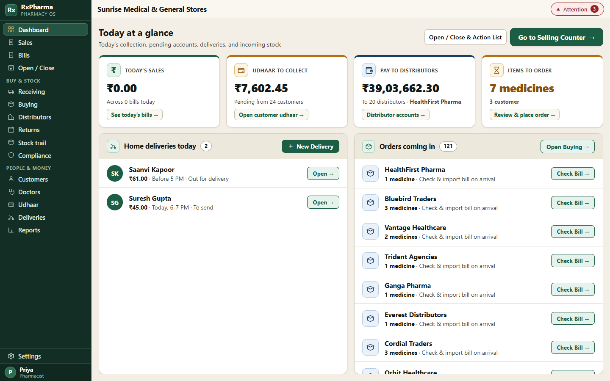

---

### 02. Dashboard ? Attention & Notifications Popover
- **File:** [`screenshots/02-Dashboard-Attention-Notifications-Popover.png`](./screenshots/02-Dashboard-Attention-Notifications-Popover.png)
- **Description:** Top-bar standing-awareness popover showing cold-chain status, low stock, and pending operational alerts.

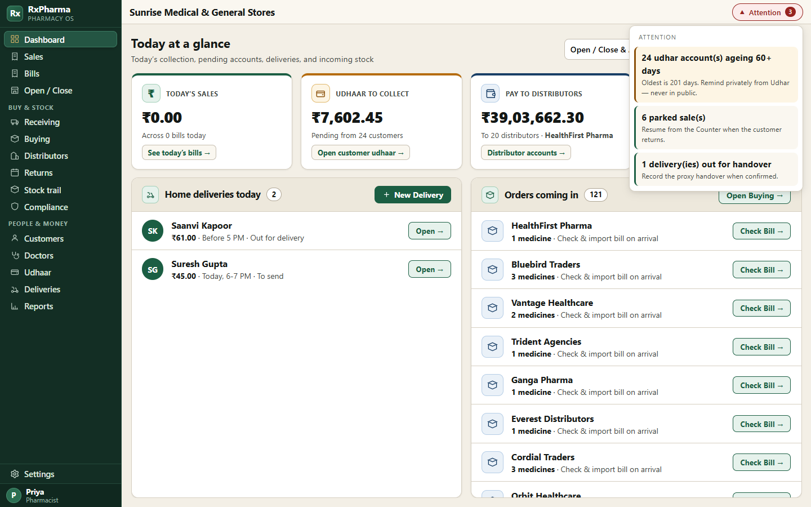

---

## 2. Sales Counter (Billing, Availability Check, Batches & Tabs) (`#/billing`)

### 03. Sales Counter ? Main Billing Workspace
- **File:** [`screenshots/03-Sales-Counter-Main-Billing.png`](./screenshots/03-Sales-Counter-Main-Billing.png)
- **Description:** 10 counter slots, spoken/typed request bar, inline batch selector, strip/tab unit toggle, medicine & bill discounts, and side-by-side Medicine & Totals panels.

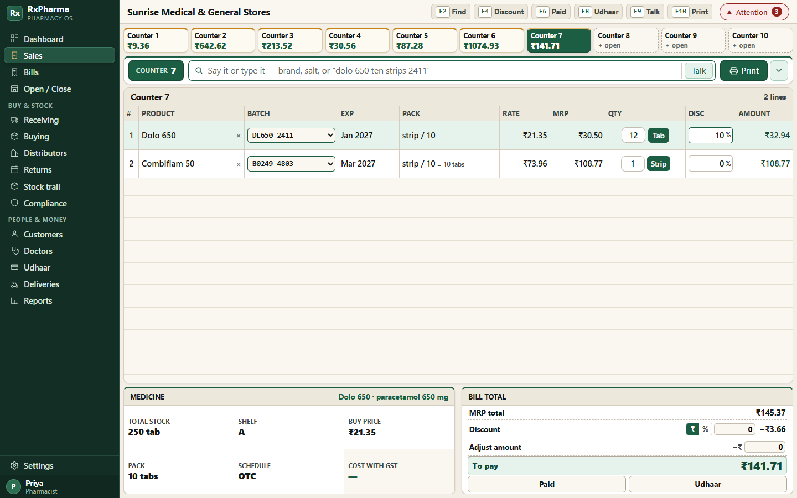

---

### 04. Sales Counter ? Medicine Search & Same-Salt Substitutes
- **File:** [`screenshots/04-Sales-Counter-Medicine-Search-And-Substitutes.png`](./screenshots/04-Sales-Counter-Medicine-Search-And-Substitutes.png)
- **Description:** Instant search dropdown showing On Your Rack Now, Same Salt Other Brand, and Not On Your Rack (+ Add to buy list).

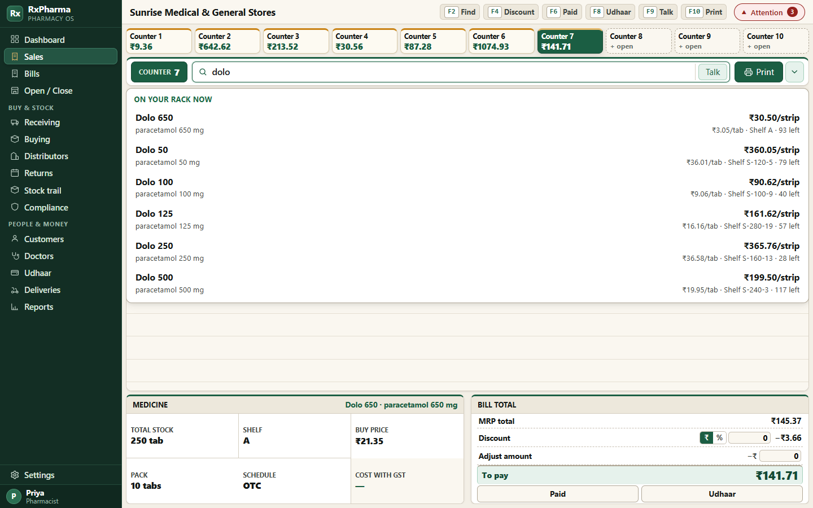

---

### 05. Sales Counter ? Medicine Availability Check ('Check Dolo 650')
- **File:** [`screenshots/05-Sales-Counter-Availability-Check-Card.png`](./screenshots/05-Sales-Counter-Availability-Check-Card.png)
- **Description:** Shows usable stock, customer reservations, incoming POs, open requests, recorded batches, and one-click '+ Add 1 strip to bill' or '+ Create pending customer request'.

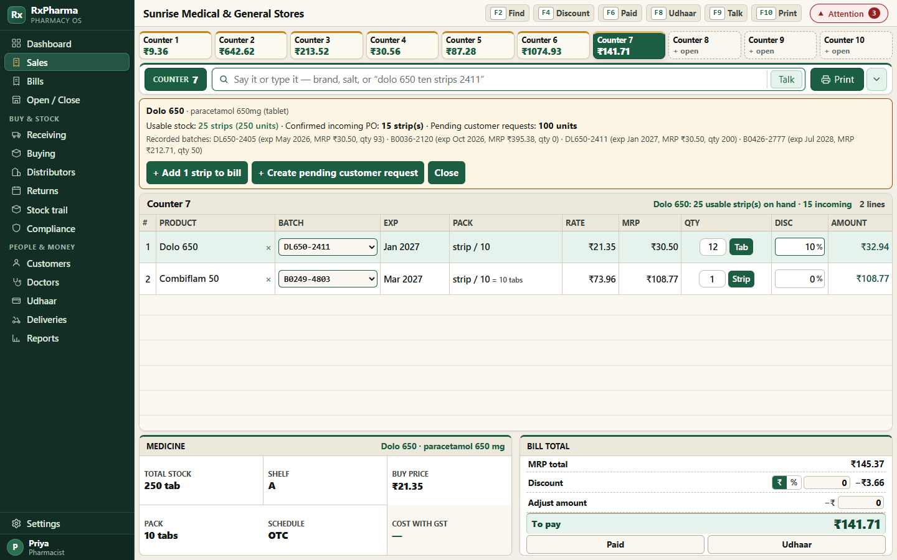

---

### 06. Sales Counter ? Batch Options Picker ('Show the batch options')
- **File:** [`screenshots/06-Sales-Counter-Batch-Picker-Panel.png`](./screenshots/06-Sales-Counter-Batch-Picker-Panel.png)
- **Description:** Explicit physical batch verification and selection panel, including batches with customer reservations or zero recorded stock.

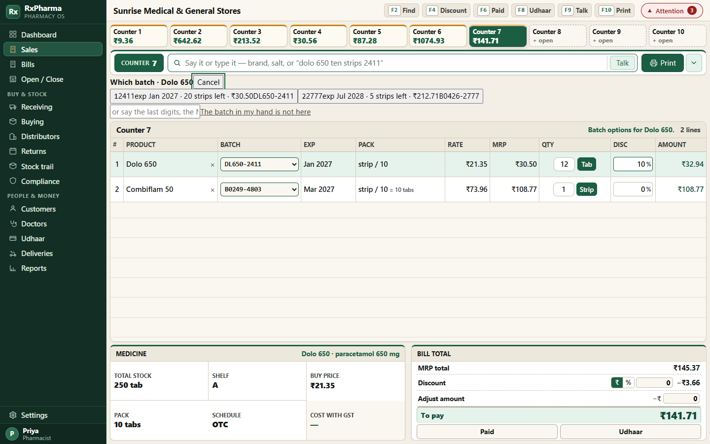

---

### 07. Sales Counter ? Bill Options Menu
- **File:** [`screenshots/07-Sales-Counter-Bill-Options-Menu.png`](./screenshots/07-Sales-Counter-Bill-Options-Menu.png)
- **Description:** Dropdown menu for Save bill only, Plain Paper print, Customer details, and Saved bills.

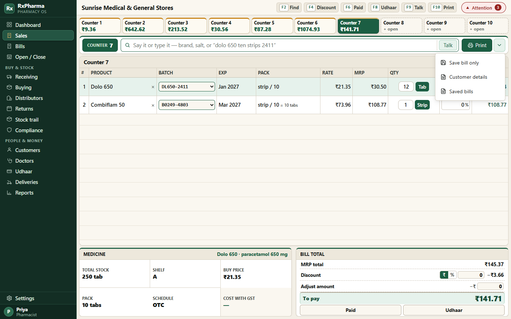

---

### 08. Sales Counter ? Customer & Prescriber Details Modal
- **File:** [`screenshots/08-Sales-Counter-Customer-Details-Modal.png`](./screenshots/08-Sales-Counter-Customer-Details-Modal.png)
- **Description:** Attach customer name, address, and prescribing doctor to the active counter bill.

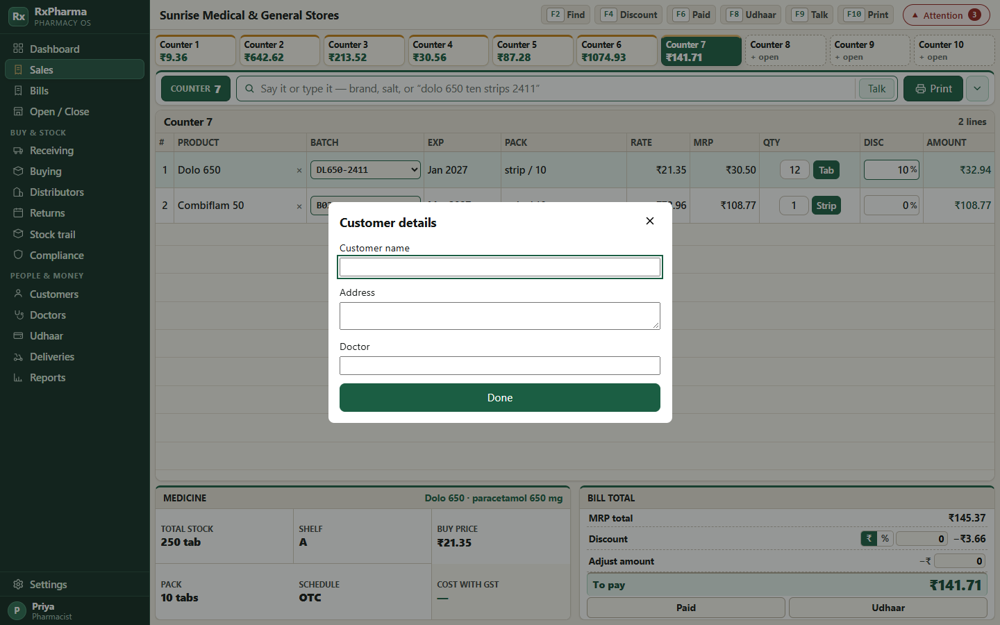

---

### 09. Sales Counter ? Totals Tab (Compact View)
- **File:** [`screenshots/09-Sales-Counter-Compact-Totals-Tab.png`](./screenshots/09-Sales-Counter-Compact-Totals-Tab.png)
- **Description:** Counter detail panel switched to the Totals tab (MRP total, Discount, Adjust amount, Paid / Udhaar, To pay).

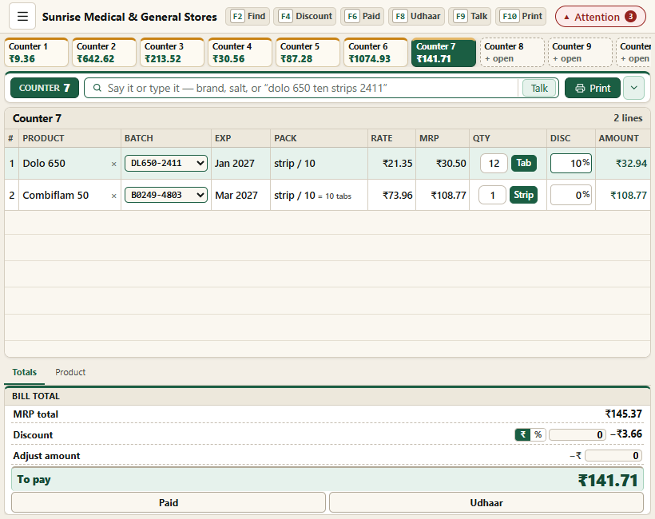

---

### 10. Sales Counter ? Product Tab (Compact View)
- **File:** [`screenshots/10-Sales-Counter-Compact-Product-Tab.png`](./screenshots/10-Sales-Counter-Compact-Product-Tab.png)
- **Description:** Counter detail panel switched to the Product tab (Total stock, Shelf, Buy price, Pack, Schedule, Cost with GST).

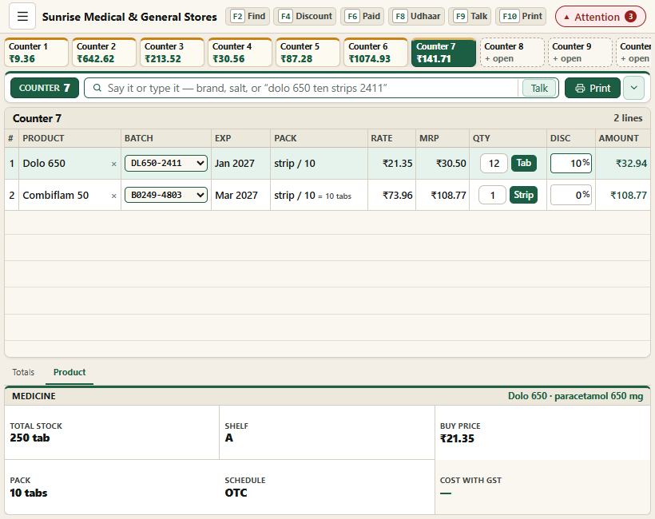

---

## 3. Saved Bills & Print Preview (`#/bills`)

### 11. Bills ? Saved Bills Search & History
- **File:** [`screenshots/11-Bills-Saved-Bills-List.png`](./screenshots/11-Bills-Saved-Bills-List.png)
- **Description:** Search saved bills by bill number, customer name, and date range (From / To).

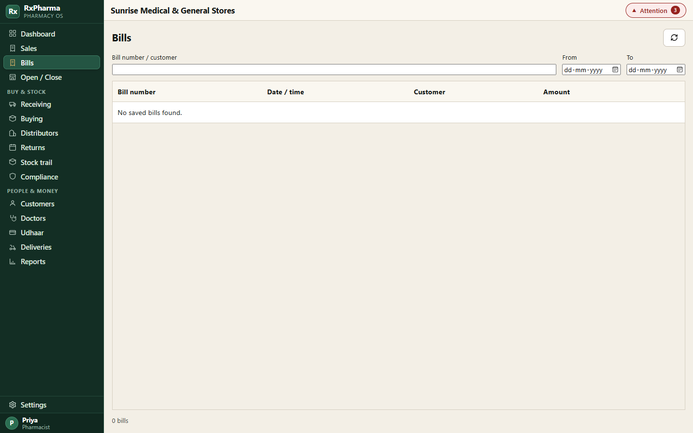

---

### 12. Bills ? Bill Print Preview Dialog
- **File:** [`screenshots/12-Bill-Print-Preview-Dialog.png`](./screenshots/12-Bill-Print-Preview-Dialog.png)
- **Description:** Exact stationery / A4 print preview dialog with printer selection and one-click reprint.

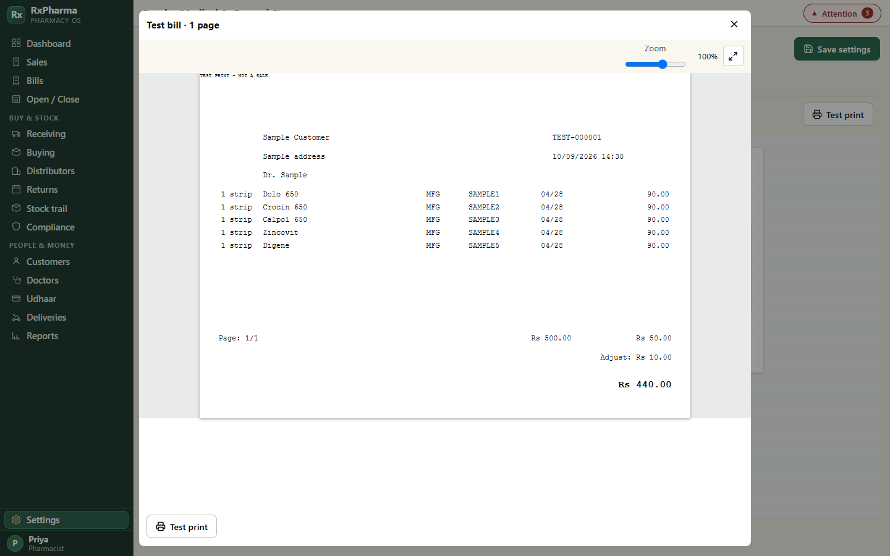

---

## 4. Open / Close Shop & Daily Action Summary (`#/day`)

### 13. Open / Close ? Cold Chain, Cash Drawer & Daily Action Summary
- **File:** [`screenshots/13-Open-Close-Day-And-Action-Summary.png`](./screenshots/13-Open-Close-Day-And-Action-Summary.png)
- **Description:** Cold-chain status, near-expiry stock, opening float, cash takings, today's sales by payment method (Paid vs Udhaar), and prioritised 'What needs your attention today' / 'Closing summary' action cards.

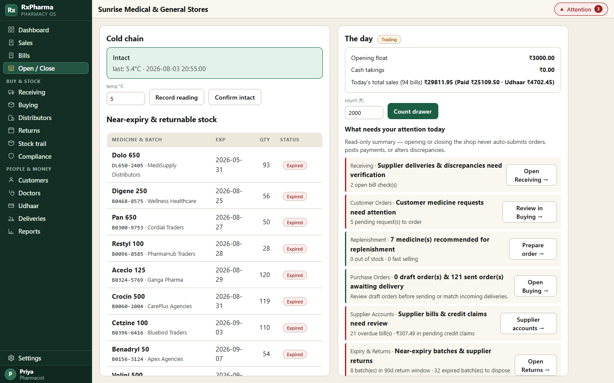

---

## 5. Receiving Goods & Physical Purchase Invoices (`#/receiving`)

### 14. Receiving ? Bills Being Checked & Email/WhatsApp Queue
- **File:** [`screenshots/14-Receiving-Email-And-WhatsApp-Queue.png`](./screenshots/14-Receiving-Email-And-WhatsApp-Queue.png)
- **Description:** Open receipts in progress ('Bills being checked') and incoming distributor bills fetched from Email & WhatsApp.

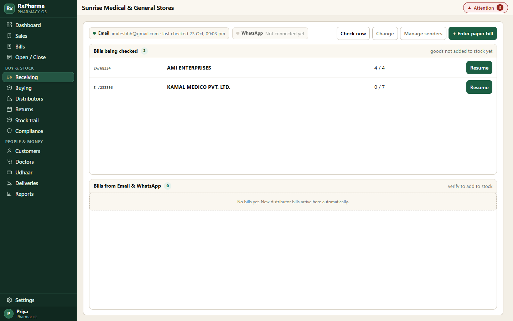

---

### 15. Receiving ? Manage Approved Distributor Senders
- **File:** [`screenshots/15-Receiving-Manage-Senders-Panel.png`](./screenshots/15-Receiving-Manage-Senders-Panel.png)
- **Description:** Whitelist of distributor bill email addresses allowed into the receiving queue.

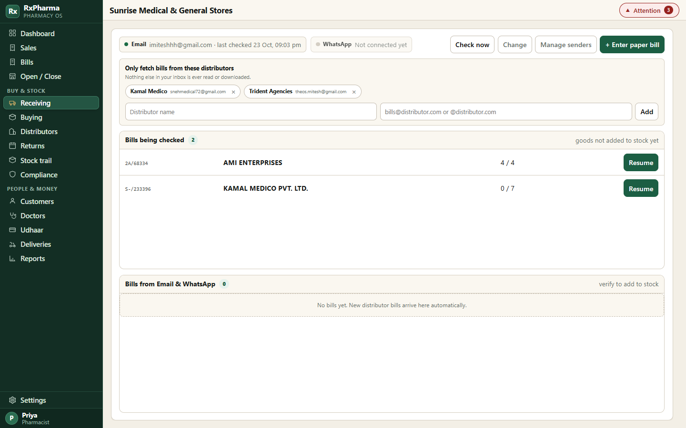

---

### 16. Receiving ? Enter Physical Paper Bill & PO Prefill Drawer
- **File:** [`screenshots/16-Receiving-Enter-Paper-Bill-Drawer.png`](./screenshots/16-Receiving-Enter-Paper-Bill-Drawer.png)
- **Description:** Receive goods against a physical paper invoice or prefill lines directly from an awaiting Purchase Order.

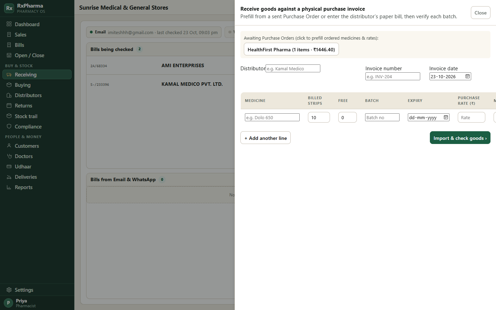

---

### 17. Receiving ? Check the Goods Against the Bill (BillCheck Drawer)
- **File:** [`screenshots/17-Receiving-Bill-Check-Goods-Verification-Drawer.png`](./screenshots/17-Receiving-Bill-Check-Goods-Verification-Drawer.png)
- **Description:** Line-by-line batch/expiry/Rate/MRP/quantity verification, multi-batch splitting, spoken/quick discrepancy command bar, bill amendments, and credit note expectations.

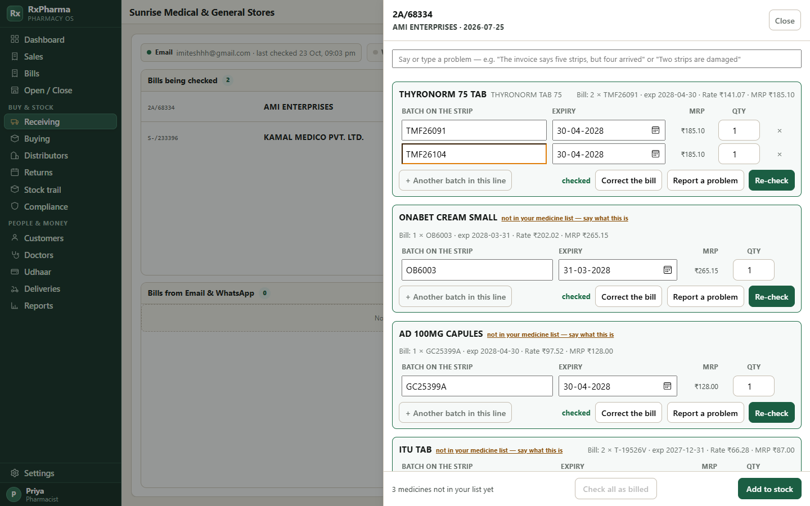

---

## 6. Buying, Distributor Comparison & Minimum-Order Review (All Tabs & Filters) (`#/buying`)

### 18. Buying ? 'To buy' Tab (All Recommendations & Arrived Orders)
- **File:** [`screenshots/18-Buying-To-Buy-Tab-All.png`](./screenshots/18-Buying-To-Buy-Tab-All.png)
- **Description:** Ranked purchase recommendations (Customer orders, Catch, Fast Selling, Low Stock), 'Arrived for customers' pickup bar with 'Bill at Counter', and distributor draft baskets.

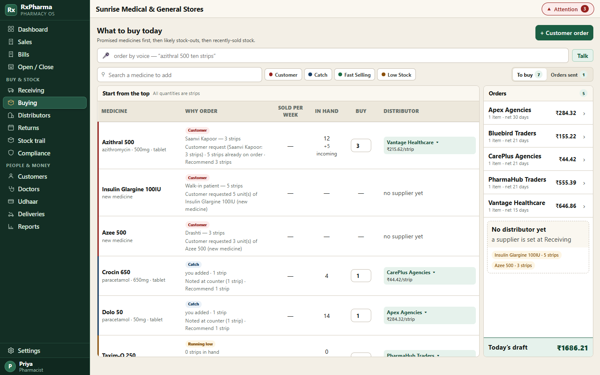

---

### 19. Buying ? '+ Customer order' Quick Entry Form
- **File:** [`screenshots/19-Buying-Add-Customer-Order-Form.png`](./screenshots/19-Buying-Add-Customer-Order-Form.png)
- **Description:** Record a new customer medicine request with customer name, quantity, and needed-by date.

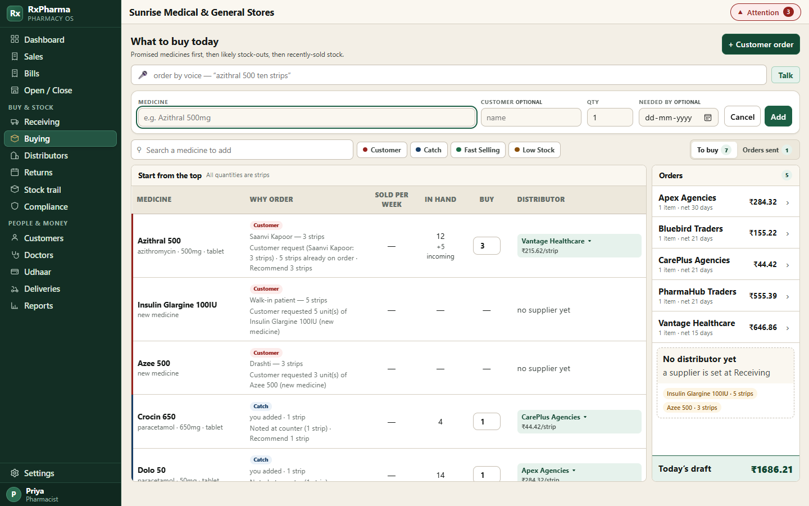

---

### 20. Buying ? 'To buy' Tab ? 'Customer' Filter
- **File:** [`screenshots/20-Buying-To-Buy-Filter-Customer-Tab.png`](./screenshots/20-Buying-To-Buy-Filter-Customer-Tab.png)
- **Description:** Filtered view showing only medicines requested by waiting customers.

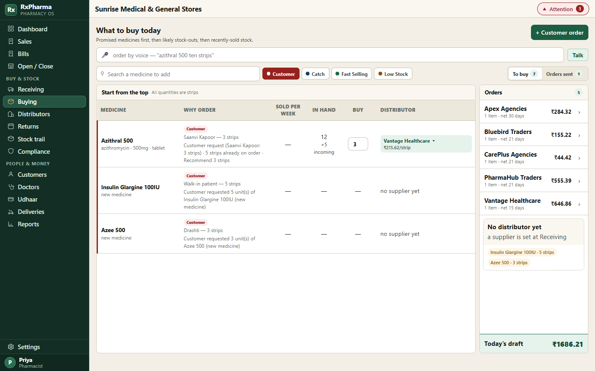

---

### 21. Buying ? 'To buy' Tab ? 'Catch' Filter
- **File:** [`screenshots/21-Buying-To-Buy-Filter-Catch-Tab.png`](./screenshots/21-Buying-To-Buy-Filter-Catch-Tab.png)
- **Description:** Filtered view showing counter catch / shortbook items noted during the day.

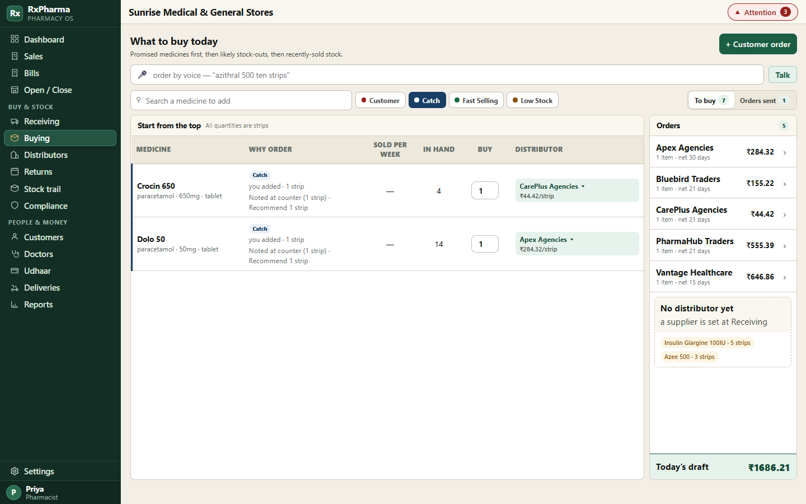

---

### 22. Buying ? 'To buy' Tab ? 'Fast Selling' Filter
- **File:** [`screenshots/22-Buying-To-Buy-Filter-Fast-Selling-Tab.png`](./screenshots/22-Buying-To-Buy-Filter-Fast-Selling-Tab.png)
- **Description:** Filtered view showing high-velocity medicines needing replenishment.

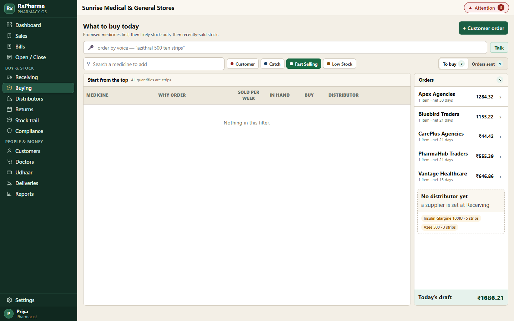

---

### 23. Buying ? 'To buy' Tab ? 'Low Stock' Filter
- **File:** [`screenshots/23-Buying-To-Buy-Filter-Low-Stock-Tab.png`](./screenshots/23-Buying-To-Buy-Filter-Low-Stock-Tab.png)
- **Description:** Filtered view showing out-of-stock and running-low medicines.

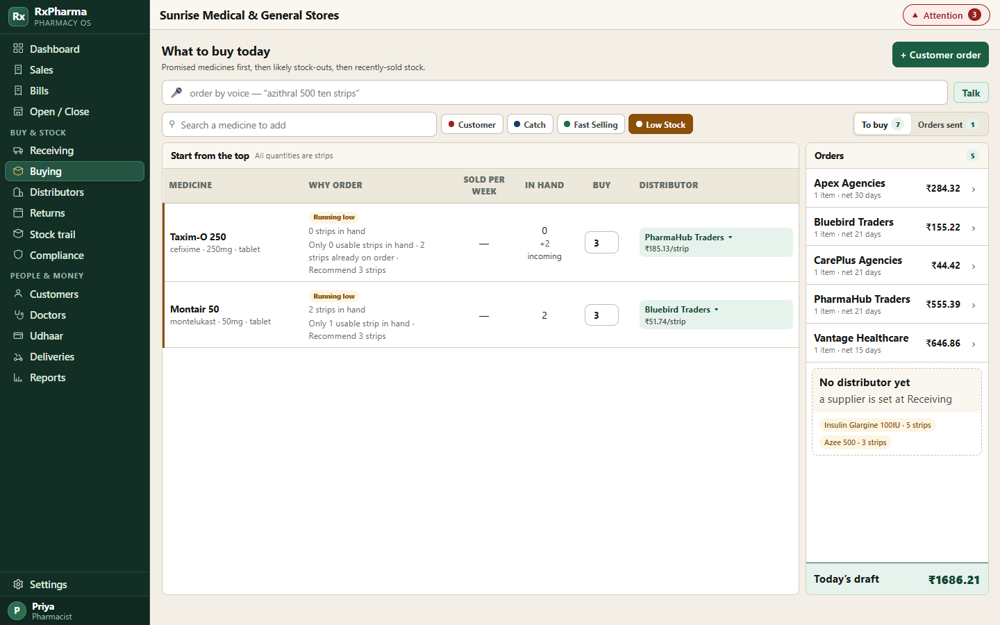

---

### 24. Buying ? Distributor & Scheme Comparison Modal
- **File:** [`screenshots/24-Buying-Distributor-And-Scheme-Compare-Modal.png`](./screenshots/24-Buying-Distributor-And-Scheme-Compare-Modal.png)
- **Description:** Side-by-side comparison of suppliers for a medicine: scheme rules (free qty & % discount), list rate, net cost on bills, MRP, credit terms, min order, and payable vs effective cost.

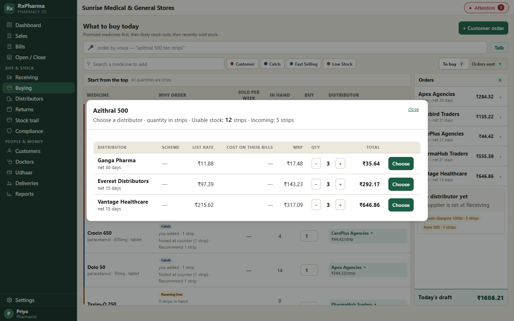

---

### 25. Buying ? Distributor Draft Order & Minimum-Order Top-Up Review Modal
- **File:** [`screenshots/25-Buying-Order-Draft-And-Min-Order-Review-Modal.png`](./screenshots/25-Buying-Order-Draft-And-Min-Order-Review-Modal.png)
- **Description:** Review proposed distributor order, evaluate legitimate 30-day replenishment top-ups when below minimum order value, and send by Mail / Delivery guy / WhatsApp.

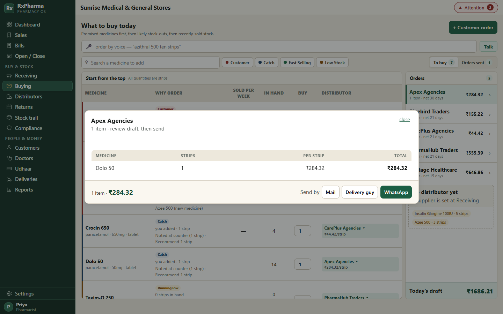

---

### 26. Buying ? 'Orders sent' Tab
- **File:** [`screenshots/26-Buying-Orders-Sent-Tab.png`](./screenshots/26-Buying-Orders-Sent-Tab.png)
- **Description:** Purchase orders already sent to distributors and awaiting delivery.

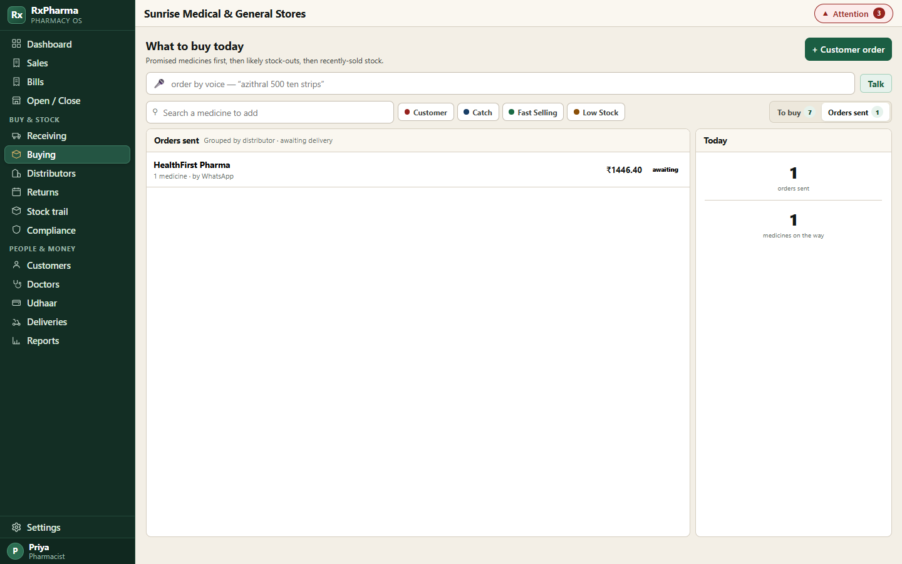

---

## 7. Distributors, Supplier Accounts, Credit Notes & Reconciliation (All Tabs) (`#/distributors`)

### 27. Distributors Directory ? 'All' Tab
- **File:** [`screenshots/27-Distributors-Directory-All-Tab.png`](./screenshots/27-Distributors-Directory-All-Tab.png)
- **Description:** All suppliers with credit terms, minimum order value, last purchase bill, overdue/due-soon badges, pending credit claims, unpaid bills, and net payable total.

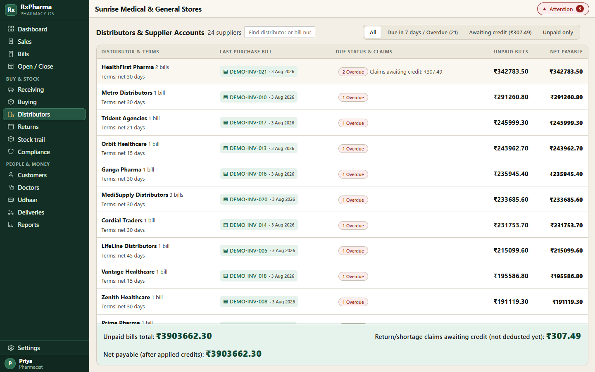

---

### 28. Distributors Directory ? 'Due in 7 days / Overdue' Tab
- **File:** [`screenshots/28-Distributors-Directory-Due-In-7-Days-Tab.png`](./screenshots/28-Distributors-Directory-Due-In-7-Days-Tab.png)
- **Description:** Suppliers with bills approaching their credit due date or already overdue.

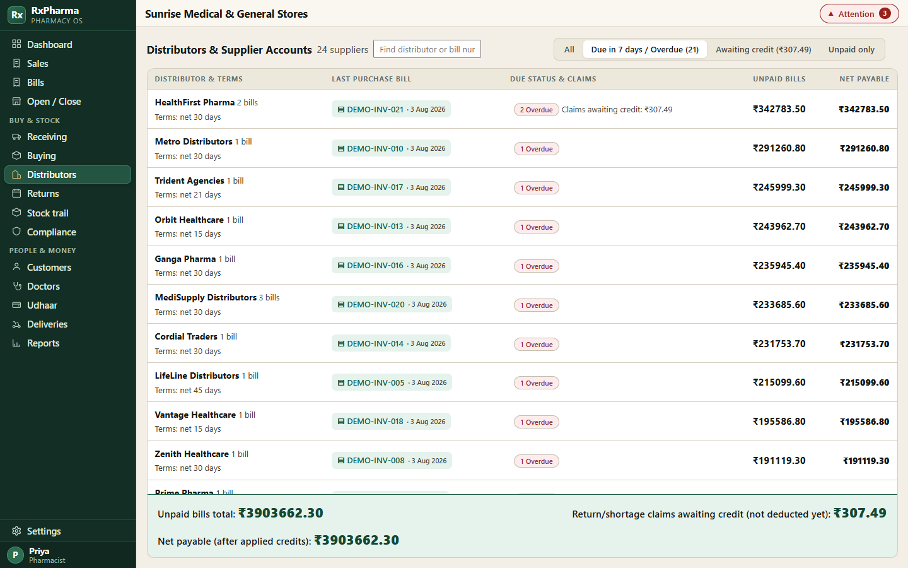

---

### 29. Distributors Directory ? 'Awaiting credit' Tab
- **File:** [`screenshots/29-Distributors-Directory-Awaiting-Credit-Tab.png`](./screenshots/29-Distributors-Directory-Awaiting-Credit-Tab.png)
- **Description:** Suppliers with pending return or shortage credit claims awaiting adjustment.

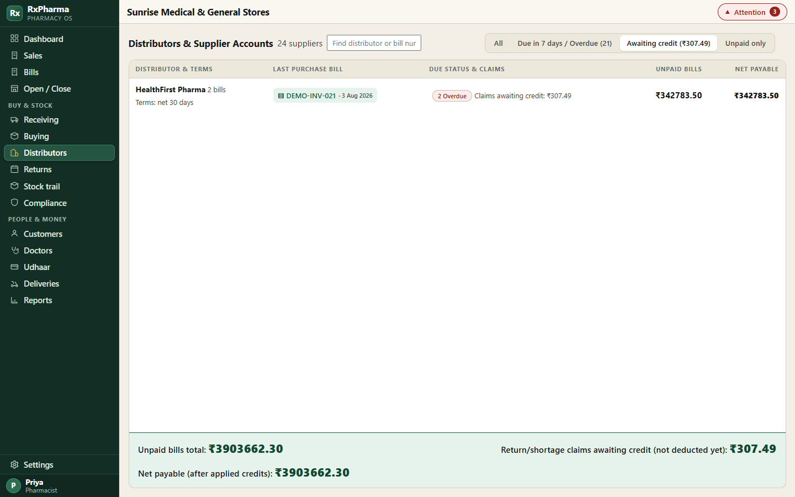

---

### 30. Distributors Directory ? 'Unpaid only' Tab
- **File:** [`screenshots/30-Distributors-Directory-Unpaid-Only-Tab.png`](./screenshots/30-Distributors-Directory-Unpaid-Only-Tab.png)
- **Description:** Suppliers with an active unpaid balance.

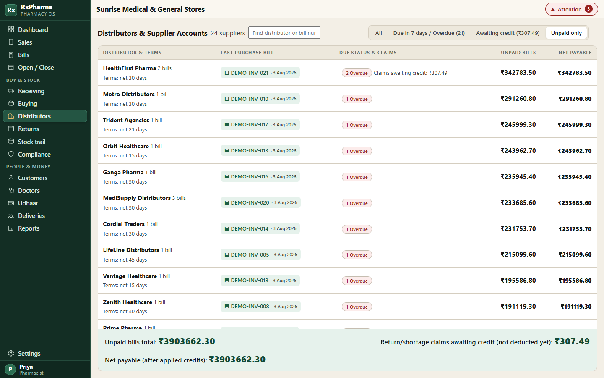

---

### 31. Distributor Account ? Overview, Credit Notes & All Bills
- **File:** [`screenshots/31-Distributors-Account-Overview-All-Bills.png`](./screenshots/31-Distributors-Account-Overview-All-Bills.png)
- **Description:** Individual supplier ledger showing gross, applied credit notes, claims awaiting credit (not deducted until confirmed & applied), net payable, and multi-bill payment allocation.

---

### 32. Distributor Account ? Reconcile Supplier Statement Panel
- **File:** [`screenshots/32-Distributors-Account-Reconcile-Statement.png`](./screenshots/32-Distributors-Account-Reconcile-Statement.png)
- **Description:** Compare a supplier's statement amount against recorded net payable and surface any variance.

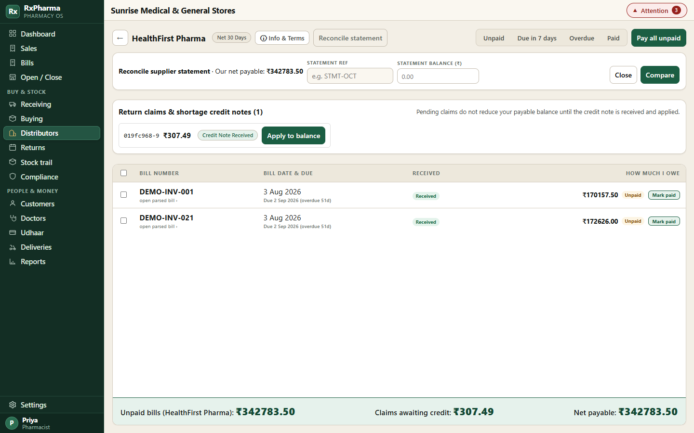

---

### 33. Distributor Account ? 'Unpaid' Bills Filter Tab
- **File:** [`screenshots/33-Distributors-Account-Unpaid-Bills-Tab.png`](./screenshots/33-Distributors-Account-Unpaid-Bills-Tab.png)
- **Description:** Filtered list of unpaid accepted purchase bills ready for payment allocation.

---

### 34. Distributor Account ? 'Due in 7 days' Bills Filter Tab
- **File:** [`screenshots/34-Distributors-Account-Due-In-7-Days-Tab.png`](./screenshots/34-Distributors-Account-Due-In-7-Days-Tab.png)
- **Description:** Filtered list of unpaid bills due within 7 days or overdue.

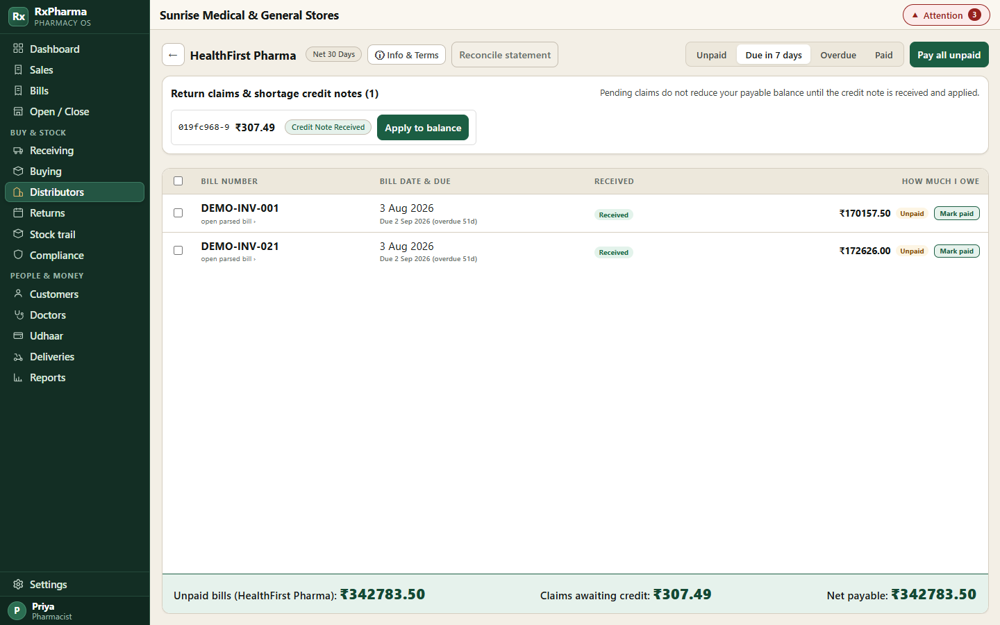

---

### 35. Distributor Account ? 'Overdue' Bills Filter Tab
- **File:** [`screenshots/35-Distributors-Account-Overdue-Bills-Tab.png`](./screenshots/35-Distributors-Account-Overdue-Bills-Tab.png)
- **Description:** Filtered list of overdue unpaid bills calculated from bill date + credit terms.

---

### 36. Distributor Account ? 'Paid' Bills Filter Tab
- **File:** [`screenshots/36-Distributors-Account-Paid-Bills-Tab.png`](./screenshots/36-Distributors-Account-Paid-Bills-Tab.png)
- **Description:** Settled bills showing payment method (Cheque / UPI / Cash), reference number, paid date, and Undo/reopen option for bounced cheques.

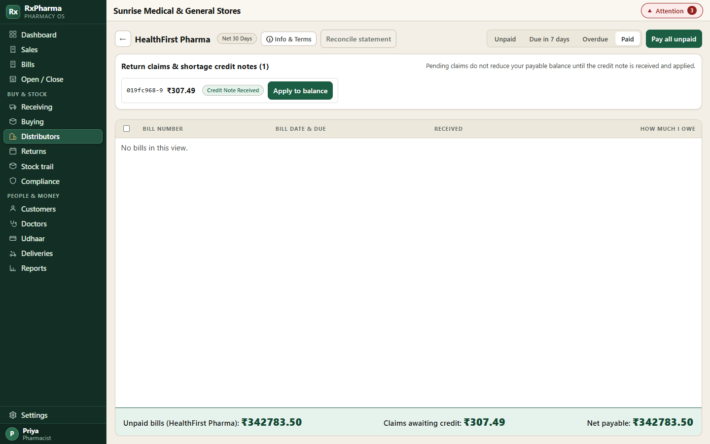

---

### 37. Distributor Account ? 'Info & Terms' Modal
- **File:** [`screenshots/37-Distributors-Account-Info-And-Terms-Modal.png`](./screenshots/37-Distributors-Account-Info-And-Terms-Modal.png)
- **Description:** Configure supplier credit terms, return recovery policy, minimum order value, phone numbers, email, PAN, GSTIN, and Drug Licence.

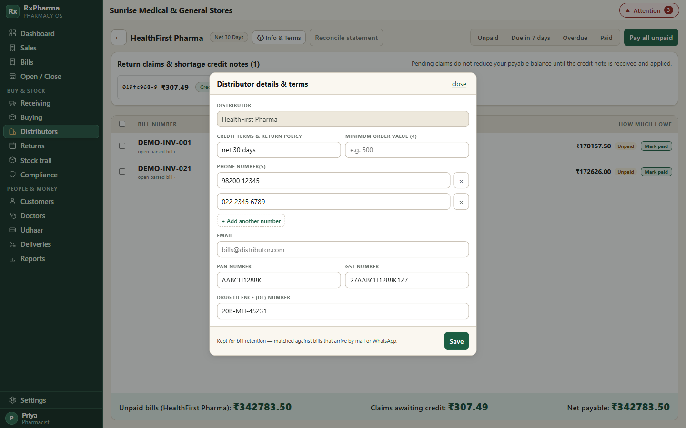

---

### 38. Distributor Account ? Purchase Bill Parsed Copy Drawer
- **File:** [`screenshots/38-Distributors-Purchase-Bill-Parsed-Copy-Drawer.png`](./screenshots/38-Distributors-Purchase-Bill-Parsed-Copy-Drawer.png)
- **Description:** Full line-by-line inspection of any historical purchase invoice directly from the supplier account.

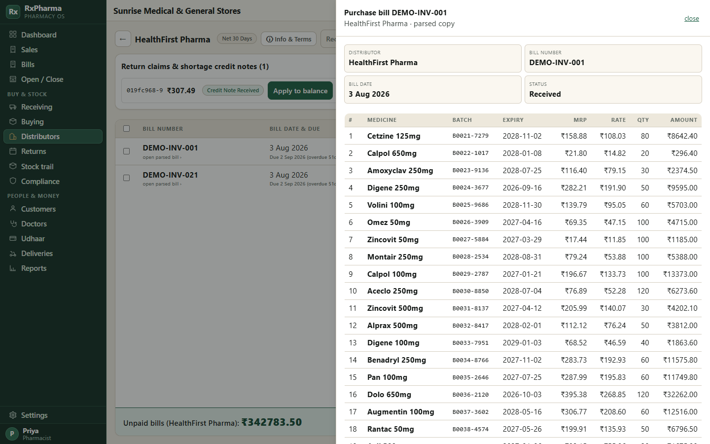

---

## 8. Near-Expiry Stock & Supplier Returns (All 4 Tabs) (`#/returns`)

### 39. Returns ? 'All' Tab (Grouped by Distributor + Return Claims)
- **File:** [`screenshots/39-Returns-All-Batches-And-Claims-Tab.png`](./screenshots/39-Returns-All-Batches-And-Claims-Tab.png)
- **Description:** Near-expiry batches grouped by supplier with source bill link, purchase rate, acquisition value, estimated recovery, bulk 'Prepare all eligible returns', and Return Claims & Credit Notes lifecycle.

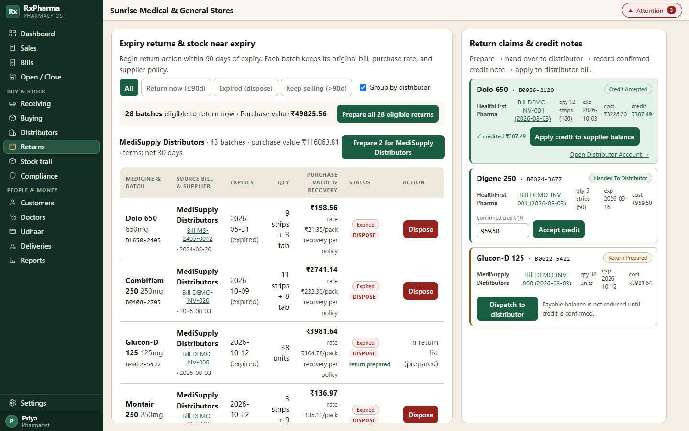

---

### 40. Returns ? 'Return now (?90d)' Tab
- **File:** [`screenshots/40-Returns-Return-Now-Within-90d-Tab.png`](./screenshots/40-Returns-Return-Now-Within-90d-Tab.png)
- **Description:** Batches inside the 90-day return window eligible to be prepared and dispatched back to the distributor.

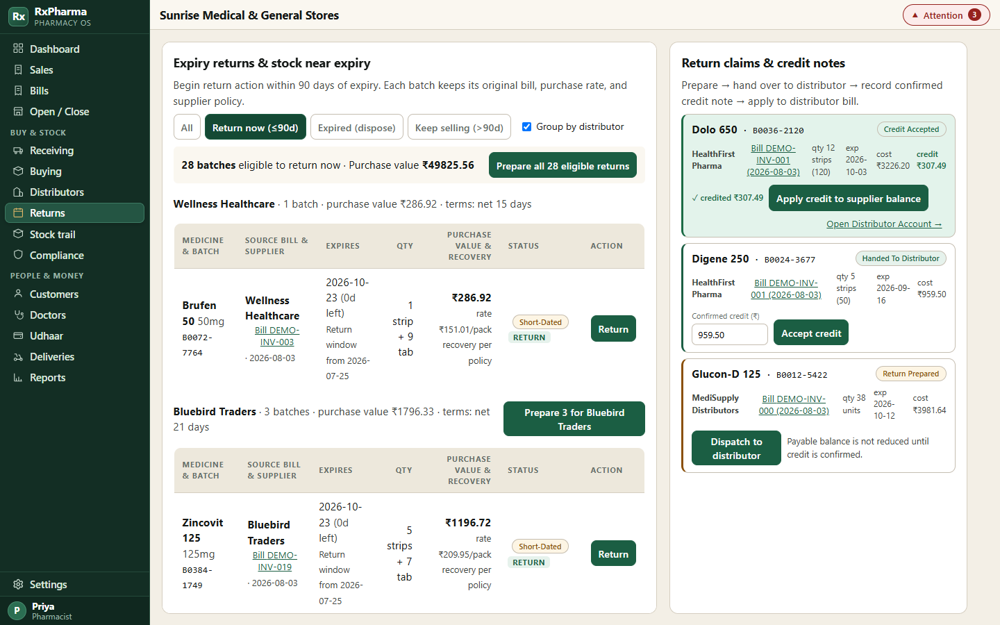

---

### 41. Returns ? 'Expired (dispose)' Tab
- **File:** [`screenshots/41-Returns-Expired-Dispose-Tab.png`](./screenshots/41-Returns-Expired-Dispose-Tab.png)
- **Description:** Expired lots that cannot return to saleable stock and must be lawfully disposed.

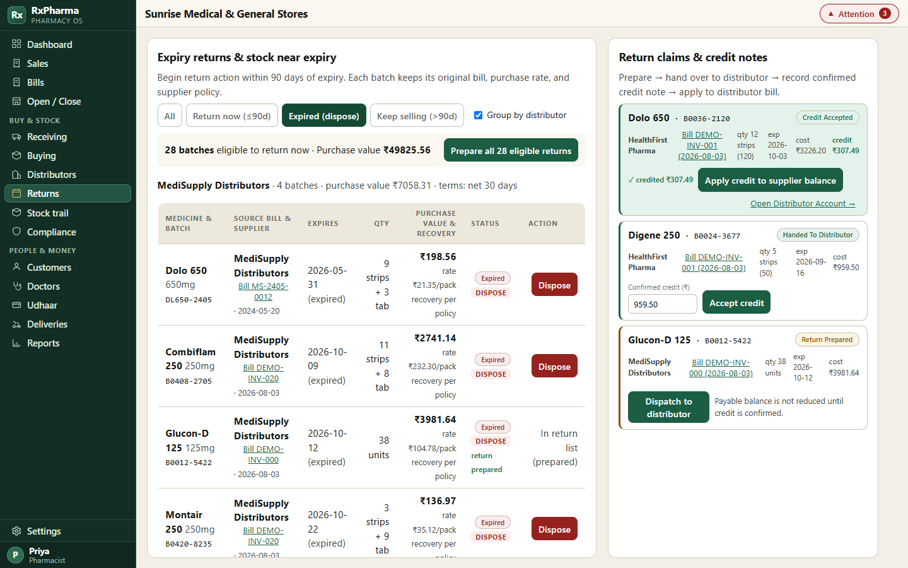

---

### 42. Returns ? 'Keep selling (>90d)' Tab
- **File:** [`screenshots/42-Returns-Keep-Selling-Over-90d-Tab.png`](./screenshots/42-Returns-Keep-Selling-Over-90d-Tab.png)
- **Description:** Stock with more than 90 days of shelf life remaining.

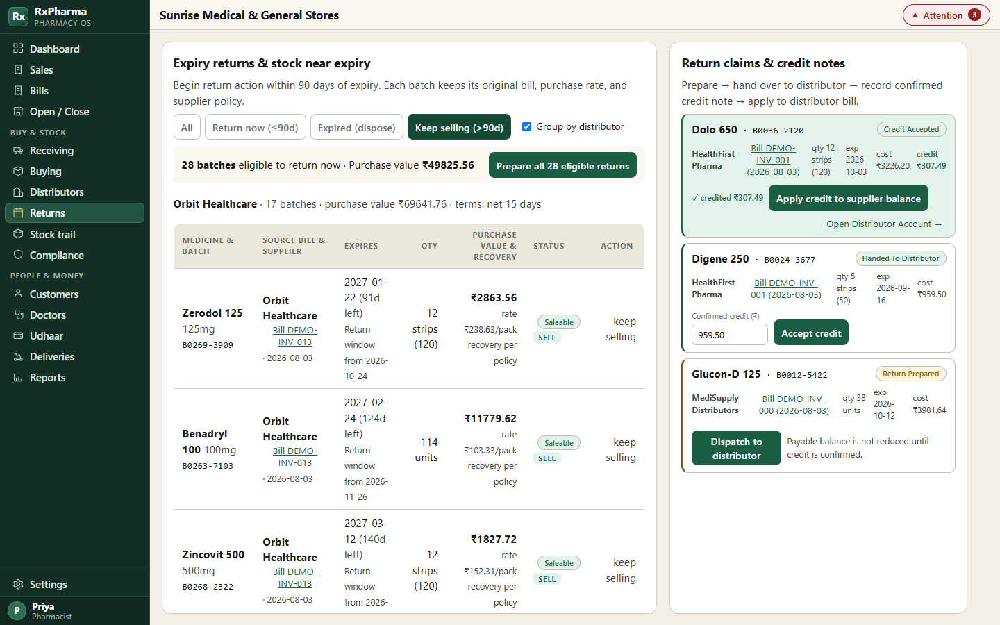

---

## 9. Stock Trail & Audit Evidence (All 7 Tabs + Drawer) (`#/trail`)

### 43. Stock Trail ? 'Batches' Tab
- **File:** [`screenshots/43-Stock-Trail-Batches-Tab.png`](./screenshots/43-Stock-Trail-Batches-Tab.png)
- **Description:** Every batch in stock showing received, sold, on-hand strips/loose units, weighted-average cost per pack, opening-stock badges, and shelf agreement status.

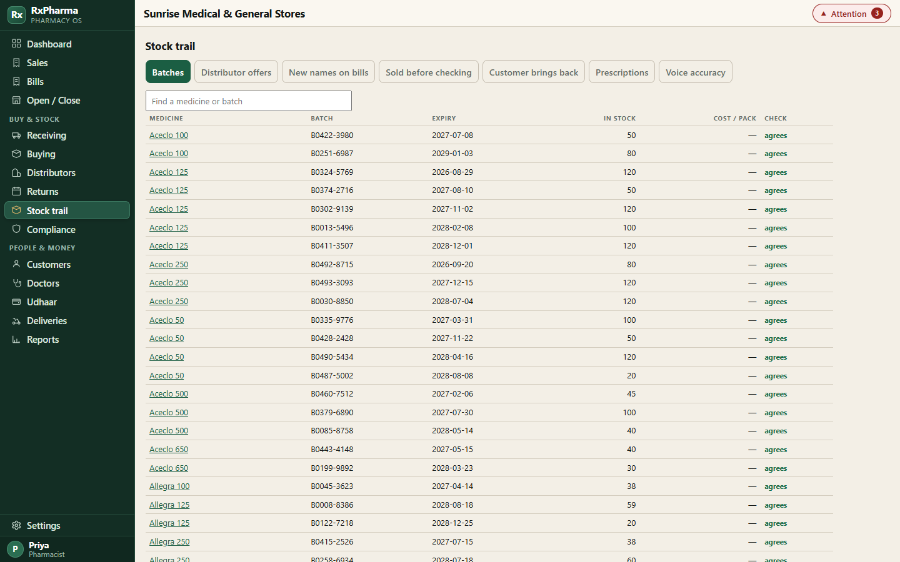

---

### 44. Stock Trail ? Batch Provenance Drawer & Shelf Count / Location Controls
- **File:** [`screenshots/44-Stock-Trail-Batch-Evidence-And-Count-Adjustment-Drawer.png`](./screenshots/44-Stock-Trail-Batch-Evidence-And-Count-Adjustment-Drawer.png)
- **Description:** Full batch history (Bought on bills, Sold on bills, Adjusted/withdrawn) plus inline 'Record count / damage' and 'Set shelf' actions.

---

### 45. Stock Trail ? 'Distributor offers' Tab
- **File:** [`screenshots/45-Stock-Trail-Distributor-Offers-Tab.png`](./screenshots/45-Stock-Trail-Distributor-Offers-Tab.png)
- **Description:** Historical rates, free packs, net cost per pack, and discount % charged by each distributor across bills.

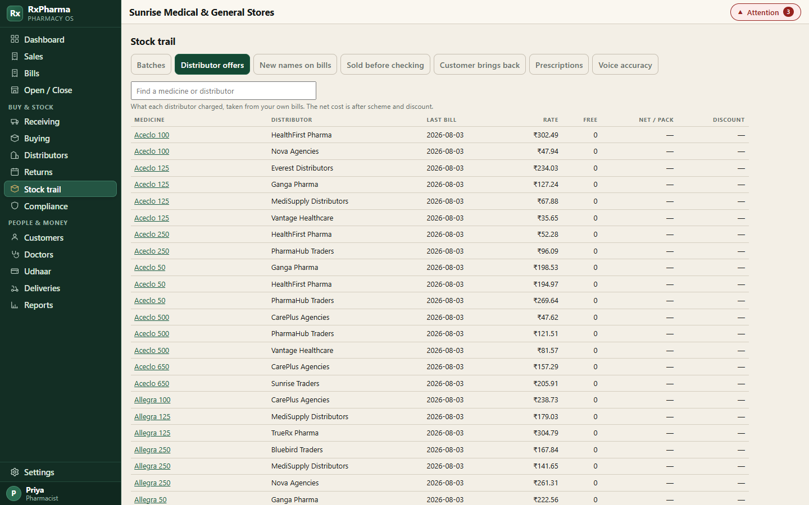

---

### 46. Stock Trail ? 'New names on bills' Tab
- **File:** [`screenshots/46-Stock-Trail-New-Names-On-Bills-Tab.png`](./screenshots/46-Stock-Trail-New-Names-On-Bills-Tab.png)
- **Description:** Unmatched medicine names seen on imported bills, ready to link to an existing medicine or catalogue as new.

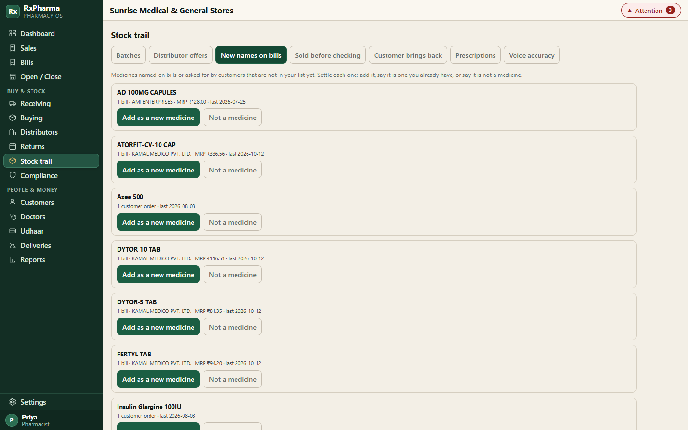

---

### 47. Stock Trail ? 'Sold before checking' Tab
- **File:** [`screenshots/47-Stock-Trail-Sold-Before-Checking-Tab.png`](./screenshots/47-Stock-Trail-Sold-Before-Checking-Tab.png)
- **Description:** Provisional lots sold at the counter before their purchase bill finished physical verification, plus sales-at-risk alerts.

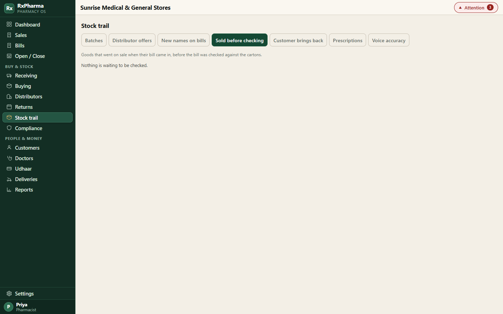

---

### 48. Stock Trail ? 'Customer brings back' Tab
- **File:** [`screenshots/48-Stock-Trail-Customer-Brings-Back-Tab.png`](./screenshots/48-Stock-Trail-Customer-Brings-Back-Tab.png)
- **Description:** Look up a customer's bill number to verify batch provenance, past purchases, and attached prescriptions before accepting a customer return.

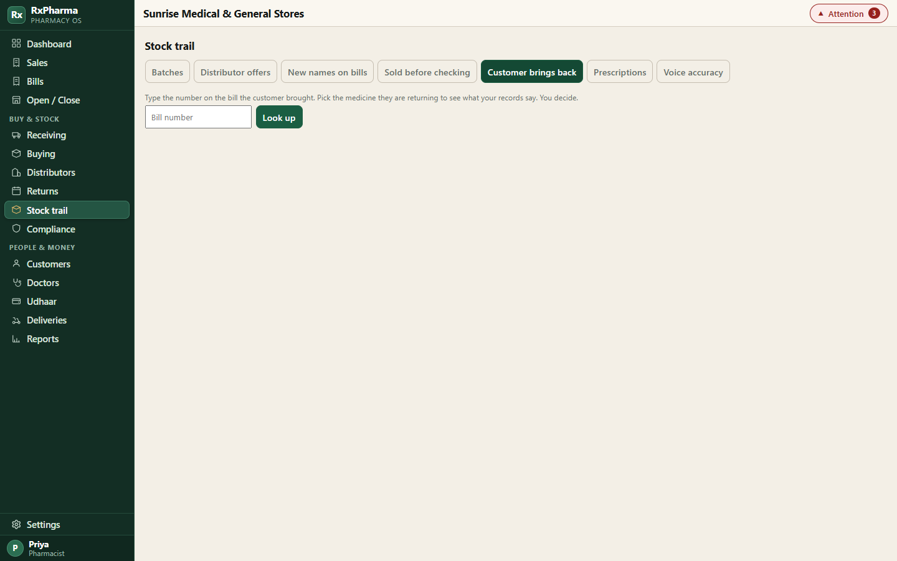

---

### 49. Stock Trail ? 'Prescriptions' Tab
- **File:** [`screenshots/49-Stock-Trail-Prescriptions-Tab.png`](./screenshots/49-Stock-Trail-Prescriptions-Tab.png)
- **Description:** Recorded patient prescriptions and how many strips/tablets have been dispensed against each.

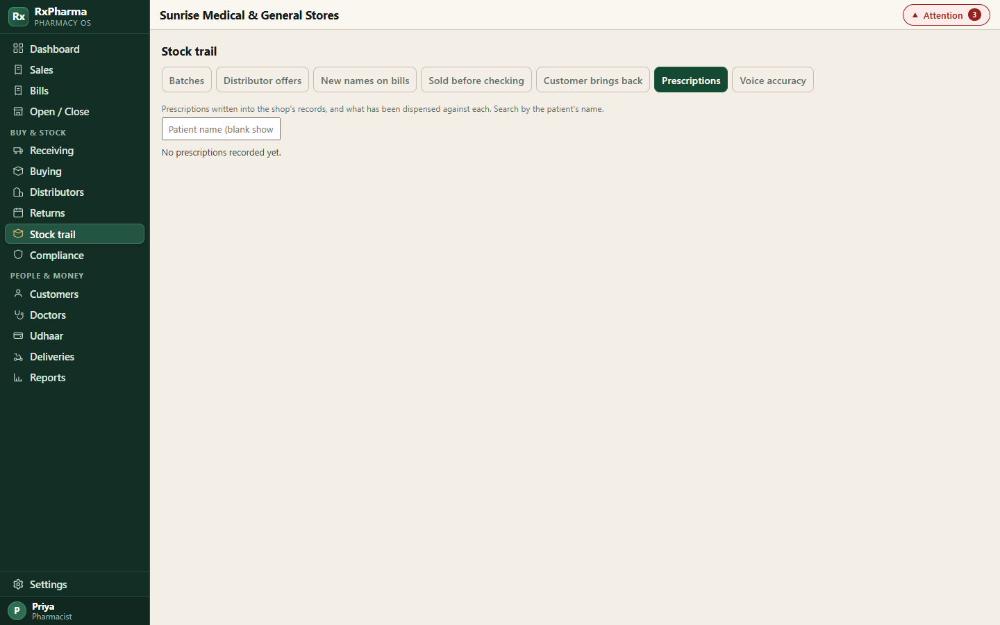

---

### 50. Stock Trail ? 'Voice accuracy' Tab
- **File:** [`screenshots/50-Stock-Trail-Voice-Accuracy-Tab.png`](./screenshots/50-Stock-Trail-Voice-Accuracy-Tab.png)
- **Description:** Per-language voice recognition metrics (accepted, corrected, not found, median time to add, and most-often-corrected phrases).

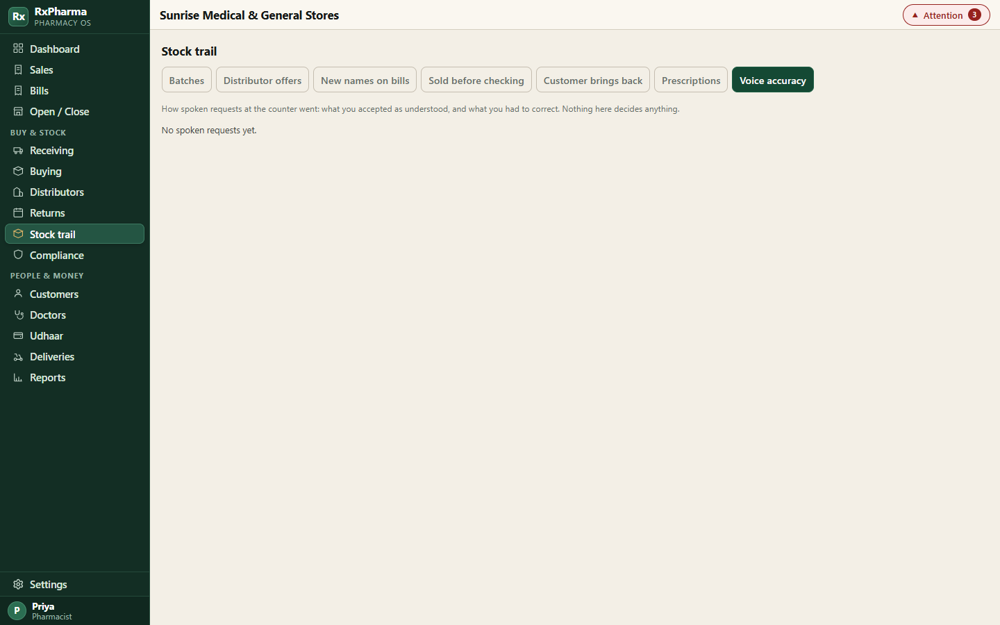

---

## 10. Compliance, Batch Recalls & Inspector Produce (Overview + 5 Artifacts) (`#/compliance`)

### 51. Compliance ? Batch Recalls & Drug Licence Overview
- **File:** [`screenshots/51-Compliance-Recalls-And-Inspector-Overview.png`](./screenshots/51-Compliance-Recalls-And-Inspector-Overview.png)
- **Description:** Issue batch-scoped recalls, compute buyer exposure, notify opted-in customers, withdraw stock, and produce read-only statutory records.

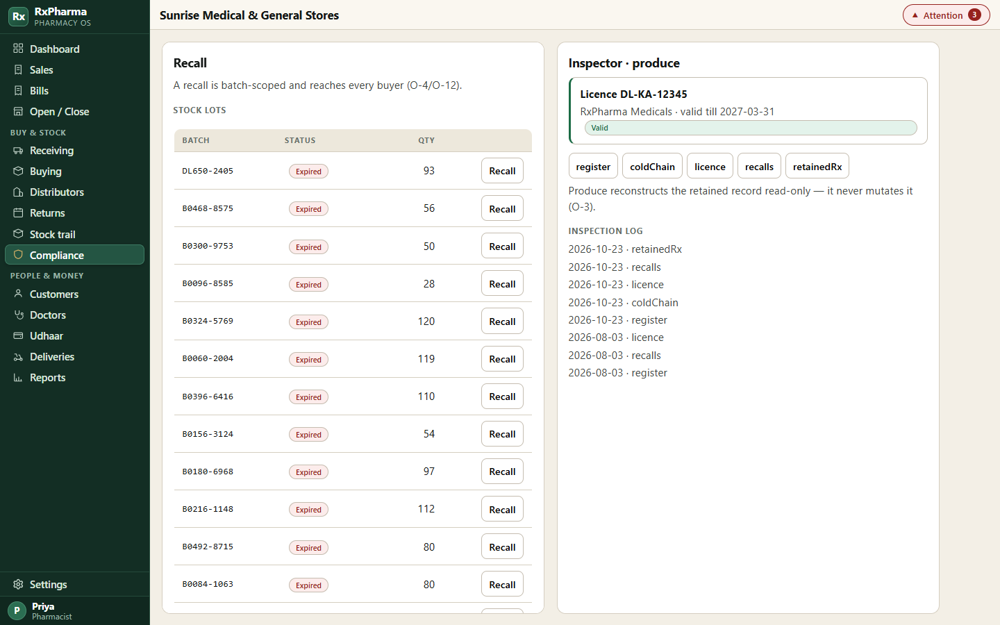

---

### 52. Compliance ? Inspector Produce: 'register' Tab
- **File:** [`screenshots/52-Compliance-Inspector-Produce-Register.png`](./screenshots/52-Compliance-Inspector-Produce-Register.png)
- **Description:** Read-only statutory Scheduled-Drugs (H1) Register artifact.

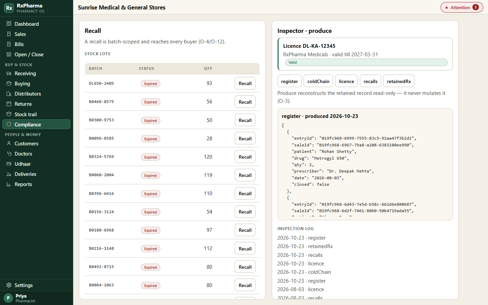

---

### 53. Compliance ? Inspector Produce: 'coldChain' Tab
- **File:** [`screenshots/53-Compliance-Inspector-Produce-ColdChain.png`](./screenshots/53-Compliance-Inspector-Produce-ColdChain.png)
- **Description:** Read-only Cold-Chain temperature log and excursion artifact.

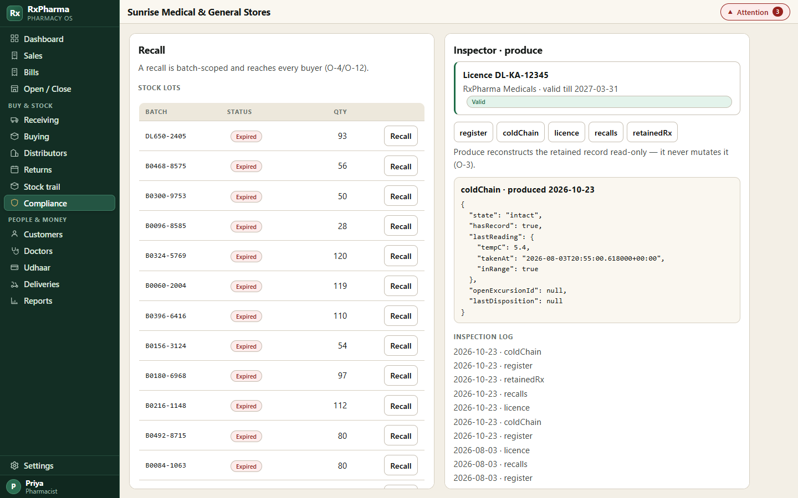

---

### 54. Compliance ? Inspector Produce: 'licence' Tab
- **File:** [`screenshots/54-Compliance-Inspector-Produce-Licence.png`](./screenshots/54-Compliance-Inspector-Produce-Licence.png)
- **Description:** Read-only Pharmacy Drug Licence status artifact.

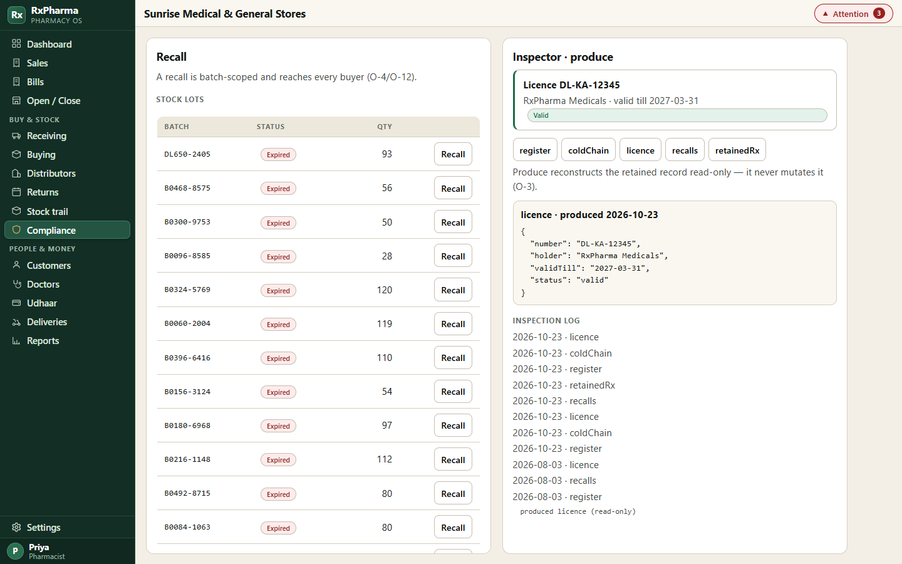

---

### 55. Compliance ? Inspector Produce: 'recalls' Tab
- **File:** [`screenshots/55-Compliance-Inspector-Produce-Recalls.png`](./screenshots/55-Compliance-Inspector-Produce-Recalls.png)
- **Description:** Read-only Batch Recalls and customer outreach artifact.

---

### 56. Compliance ? Inspector Produce: 'retainedRx' Tab
- **File:** [`screenshots/56-Compliance-Inspector-Produce-RetainedRx.png`](./screenshots/56-Compliance-Inspector-Produce-RetainedRx.png)
- **Description:** Read-only Retained Prescriptions ledger artifact.

---

## 11. Customers & Repeat-Order Previews (All 4 Tabs + Drawer) (`#/customers`)

### 57. Customers ? 'All' Tab
- **File:** [`screenshots/57-Customers-Directory-All-Tab.png`](./screenshots/57-Customers-Directory-All-Tab.png)
- **Description:** Customer directory showing contact info, repeat refill review dates, open requests, outstanding Udhaar, and linked doctor.

---

### 58. Customers ? 'Repeat expected in 7d' Tab
- **File:** [`screenshots/58-Customers-Repeat-Expected-In-7d-Tab.png`](./screenshots/58-Customers-Repeat-Expected-In-7d-Tab.png)
- **Description:** Customers whose estimated medicine supply is due for a refill review within the next 7 days.

---

### 59. Customers ? 'Open requests' Tab
- **File:** [`screenshots/59-Customers-Open-Requests-Tab.png`](./screenshots/59-Customers-Open-Requests-Tab.png)
- **Description:** Customers who currently have pending or arrived medicine requests.

---

### 60. Customers ? 'Has Udhaar' Tab
- **File:** [`screenshots/60-Customers-Has-Udhaar-Tab.png`](./screenshots/60-Customers-Has-Udhaar-Tab.png)
- **Description:** Customers with an outstanding credit balance.

---

### 61. Customers ? Previous Order & Repeat Review Drawer
- **File:** [`screenshots/61-Customers-Previous-Order-And-Repeat-Review-Drawer.png`](./screenshots/61-Customers-Previous-Order-And-Repeat-Review-Drawer.png)
- **Description:** Reviewable reference from the customer's previous bill showing usable stock, incoming POs, open requests, and one-click 'Prepare Counter Sale draft' or 'Add as Customer Request' (never auto-orders).

---

## 12. Doctors Directory (`#/doctors`)

### 62. Doctors ? Prescriber Master Directory
- **File:** [`screenshots/62-Doctors-Directory.png`](./screenshots/62-Doctors-Directory.png)
- **Description:** Add and view prescribing doctors (name, speciality, phone, registration number, clinic address).

---

## 13. Udhaar (Customer Credit & Private Reminders) (`#/udhar`)

### 63. Udhaar ? Ageing Buckets (0?30, 31?60, 60+), Repayments & WhatsApp Outbox
- **File:** [`screenshots/63-Udhaar-Receivables-And-WhatsApp-Outbox.png`](./screenshots/63-Udhaar-Receivables-And-WhatsApp-Outbox.png)
- **Description:** Track customer credit balances by age, send private opt-in reminders, forgive bad debt with dignity, record repayments, and inspect the offline WhatsApp outbox.

---

## 14. Home Deliveries (`#/delivery`)

### 64. Deliveries ? Schedule, Dispatch, Proxy Handover & Settle
- **File:** [`screenshots/64-Deliveries-Schedule-And-Handover.png`](./screenshots/64-Deliveries-Schedule-And-Handover.png)
- **Description:** Manage home deliveries with promised time windows, distinct proxy receiver capture, and Cash / UPI / Udhaar settlement.

---

## 15. Reports, GST & CA Export (All 8 Tabs) (`#/reports`)

### 65. Reports ? 'Day-book' Tab
- **File:** [`screenshots/65-Reports-Day-Book-Tab.png`](./screenshots/65-Reports-Day-Book-Tab.png)
- **Description:** Daily sales takings reconstructed from the event log, reconciled across Paid and Udhaar bills.

---

### 66. Reports ? 'Receivables' Tab
- **File:** [`screenshots/66-Reports-Receivables-Tab.png`](./screenshots/66-Reports-Receivables-Tab.png)
- **Description:** Customer Udhaar ageing summary and per-account breakdown (0?30, 31?60, 60+ days).

---

### 67. Reports ? 'Payables' Tab
- **File:** [`screenshots/67-Reports-Payables-Tab.png`](./screenshots/67-Reports-Payables-Tab.png)
- **Description:** Distributor gross, applied credit notes, true-net, and net due balances.

---

### 68. Reports ? 'Expiry' Tab
- **File:** [`screenshots/68-Reports-Expiry-Tab.png`](./screenshots/68-Reports-Expiry-Tab.png)
- **Description:** Units at risk across saleable, short-dated, and expired batches.

---

### 69. Reports ? 'GST turnover' (GST, Tax Records & CA Export) Tab
- **File:** [`screenshots/69-Reports-GST-Tax-Records-And-CA-Export-Tab.png`](./screenshots/69-Reports-GST-Tax-Records-And-CA-Export-Tab.png)
- **Description:** Period-filtered CA report with CSV download, pre-export exception checks (unverified bills, missing GSTINs, unrecorded GST rates, pending notes), sales invoices, purchase invoices, and return adjustments.

---

### 70. Reports ? 'Register' Tab
- **File:** [`screenshots/70-Reports-Scheduled-Drugs-Register-Tab.png`](./screenshots/70-Reports-Scheduled-Drugs-Register-Tab.png)
- **Description:** Statutory Scheduled-Drugs (H1) Register entries with patient, drug, quantity, prescriber, and closed status.

---

### 71. Reports ? 'Schemes' Tab
- **File:** [`screenshots/71-Reports-Scheme-Economics-Tab.png`](./screenshots/71-Reports-Scheme-Economics-Tab.png)
- **Description:** Evaluated distributor schemes showing offer terms, effective cost, expiry risk, and accept/decline recommendation.

---

### 72. Reports ? 'Adherence' Tab
- **File:** [`screenshots/72-Reports-Refill-Adherence-Tab.png`](./screenshots/72-Reports-Refill-Adherence-Tab.png)
- **Description:** Customer visit regularity and last purchase dates.

---

## 16. Settings (All 3 Tabs: Pharmacy, Bill Printing, Phones) (`#/settings`)

### 73. Settings ? 'Pharmacy' Tab
- **File:** [`screenshots/73-Settings-Pharmacy-Tab.png`](./screenshots/73-Settings-Pharmacy-Tab.png)
- **Description:** Configure pharmacy name, address, phone, email, drug licence number, GSTIN, and shop logo.

---

### 74. Settings ? 'Bill Printing' Tab (Pre-Printed Stationery Mode)
- **File:** [`screenshots/74-Settings-Bill-Printing-Preprinted-Tab.png`](./screenshots/74-Settings-Bill-Printing-Preprinted-Tab.png)
- **Description:** Visual drag-and-drop layout editor for pre-printed stationery with millimetre positioning and field toggles.

---

### 75. Settings ? 'Bill Printing' Tab (Plain Paper Mode)
- **File:** [`screenshots/75-Settings-Bill-Printing-Plain-Paper-Tab.png`](./screenshots/75-Settings-Bill-Printing-Plain-Paper-Tab.png)
- **Description:** Visual layout editor for full Plain Paper bills including pharmacy header, licence, and GST details.

---

### 76. Settings ? 'Phones' Tab
- **File:** [`screenshots/76-Settings-Phones-Tab.png`](./screenshots/76-Settings-Phones-Tab.png)
- **Description:** Enable network access for paired shop phones (used as counter microphone or strip scanner), generate one-time pairing codes, and revoke lost devices.

---

